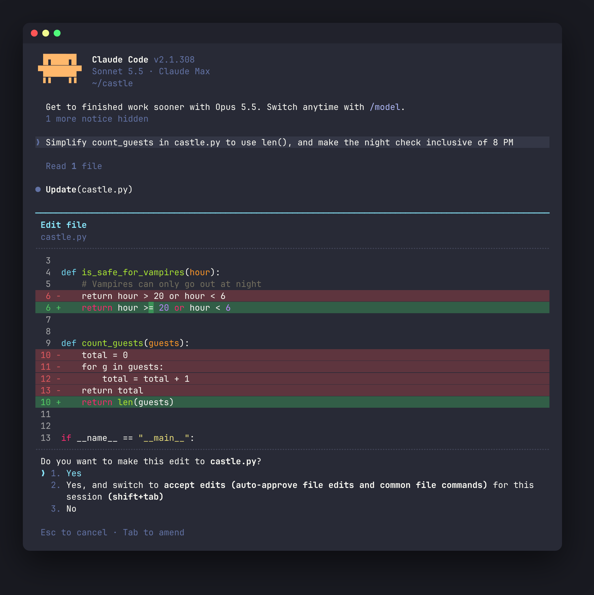

### [Claude Code](https://claude.com/product/claude-code)

#### Desktop app and claude.ai

Dracula is built into Claude Code - no files to download or install. It works in the desktop app and on [claude.ai](https://claude.ai).

#### Activating theme

1. Open Claude - on [claude.ai](https://claude.ai) or in the desktop app (**Code** tab);
2. Click your profile in the bottom-left corner and select **Settings**;
3. Select **Claude Code** in the sidebar;
4. Under **Code appearance**, choose **Dracula** from the dropdown;
5. Boom! It's working ✨

#### Terminal (Claude Code CLI)



The CLI loads Dracula as a custom theme, shipped as a plugin from this repository. It requires Claude Code 2.1.275 or later.

##### Install as a plugin

```bash
claude plugin install dracula --marketplace dracula/claude-code
```

Or from inside a Claude Code session:

```
/plugin marketplace add dracula/claude-code
/plugin install dracula@dracula
```

##### Install manually

Download [`themes/dracula.json`](./themes/dracula.json) and copy it to `~/.claude/themes/dracula.json`.

##### Activating theme

1. Run `/theme` in Claude Code;
2. Choose **Dracula** from the list;
3. Boom! It's working ✨
